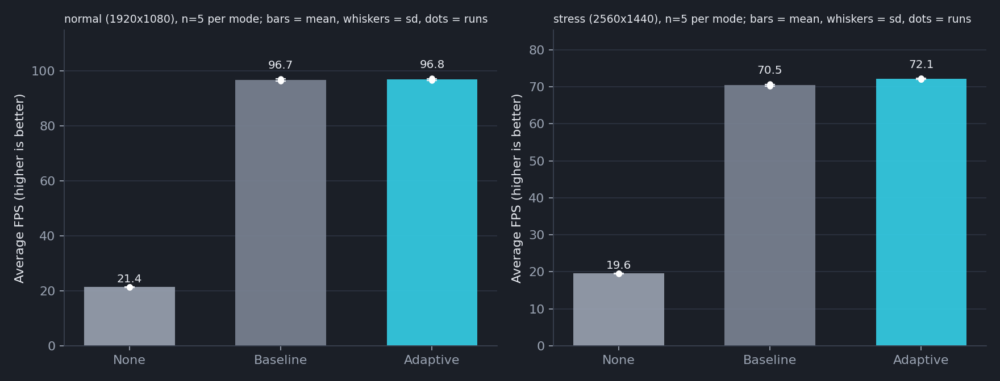
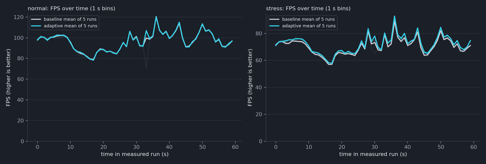

# Adaptive LOD for Vegetation in Godot

**A PI-controlled, bounded level-of-detail system for dense vegetation, with a reproducible benchmark against no LOD and a fixed-threshold baseline.**

Built with Godot 4.7.2 (GDScript) and Terrain3D 1.0.2.

**Authors:** Pravin Game, Shreeniwas Salian, Koustubh Tayade
**Institute:** Department of Computer Engineering, Pimpri Chinchwad College of Engineering

---

## What this is

Dense vegetation is expensive: tens of thousands of trees and hundreds of thousands of grass clumps multiply triangles, draw calls and overdraw. Fixed LOD distances cannot react to the frame budget. This project adds a **feedback controller**: it measures GPU render time and moves **one global bias** that scales every category's LOD thresholds, within hard limits that protect nearby detail.

Three modes run over the same scene, seed and camera path:

| Mode | What runs |
|---|---|
| `none` | Baked vegetation at full detail, every LOD policy disabled |
| `baseline` | Distance LOD for trees, grass, bushes and debris with fixed thresholds |
| `adaptive` | The same policies, thresholds scaled by a PI-controlled bias |

## Headline results

Five runs per cell, 60 s each, Quadro P3200 laptop GPU, Godot **debug/editor build**, VSync off.

| Resolution | Mode | Avg FPS | Mean frame (ms) | p99 (ms) | GPU (ms) |
|---|---|---|---|---|---|
| 1920x1080 | None | 21.4 | 46.72 | 72.0 | 46.27 |
| 1920x1080 | Baseline | 96.7 | 10.35 | 13.0 | 9.86 |
| 1920x1080 | Adaptive | 96.8 | 10.33 | 12.9 | 9.87 |
| 2560x1440 | None | 19.6 | 51.15 | 77.0 | 50.57 |
| 2560x1440 | Baseline | 70.5 | 14.19 | 18.0 | 13.59 |
| 2560x1440 | Adaptive | 72.1 | 13.87 | 17.4 | 13.29 |

- **Distance LOD does almost all of the work:** about 4.5x (1080p) and 3.6x (1440p) the FPS of no LOD, with roughly 90% fewer rendered primitives.
- **The controller adds a little:** +0.2% FPS at 1080p (GPU already under its 16.67 ms target, bias stays 0) and +2.4% at 1440p (bias saturates in 84% of frames; the 8 ms target is still not reached).
- **It is cheaper:** policy CPU time falls from about 3.3 to 0.34 ms per frame through update scheduling.




See [`FINAL_REPORT.md`](cgg-falod/results/final_run_20261023_005938/FINAL_REPORT.md) for the full evidence report and [`results_table.md`](cgg-falod/results/final_run_20261023_005938/analysis_bench/results_table.md) for per-run pairs.

## How it works

```
GPU render time -> smoothing (EMA 0.5 s, spike clip) -> PI controller (dead band, rate limits)
   -> global bias b in [0, 2]  -> per-category bias = clamp((b - onset) * gain, 0, cap)
   -> distance * (1 + bias) vs thresholds -> scheduled, budgeted MultiMesh updates
```

- **Bias convention:** `bias > 0` is coarser, `0` reproduces the baseline exactly, so one code path serves every bias.
- **Floors and caps:** trees keep LOD0 under 60 m and never use LOD2 before 100 m; caps are grass 1.0, trees 1.0, bushes 0.5, debris 0.5.
- **Smoothness:** rate limits (+0.10 up, -0.03 down per 0.25 s), 3% dead band, staggered updates and a per-update change budget.
- **No per-instance nodes:** everything is chunked `MultiMesh` data; collision and saved scenes are never touched.

Details: [`docs/adaptive_lod.md`](cgg-falod/docs/adaptive_lod.md), [`docs/multi_category_lod.md`](cgg-falod/docs/multi_category_lod.md), [`docs/vegetation_lod.md`](cgg-falod/docs/vegetation_lod.md), [`docs/benchmark.md`](cgg-falod/docs/benchmark.md).

## Repository layout

```
cgg-falod/                 Godot project
  scenes/                  environment, benchmark and demo scenes
  scripts/lod/             policies, PI controller, LodManager, self-tests
  scripts/bench/           deterministic benchmark, CSV/JSON logger, demo recorder
  scripts/ui/              F3/F4 in-game debug panel
  docs/                    design notes and measurements
  results/                 reports, analysis tables and charts (raw runs are not committed)
presentation/              earlier slide deck
cgg-falod/results/final_run_*/presentation_na/   final None-vs-Adaptive deck, PDF and speaker script
```

## Running it

Requires **Godot 4.7.2**. Open `cgg-falod/project.godot`, or from a terminal:

```
# Play: F3 shows the debug panel (FPS, per-category counts, controller state), F4 toggles None <-> Adaptive
Godot --path cgg-falod

# Benchmark one mode (modes: none | baseline | adaptive; profiles: normal 1080p | stress 1440p)
Godot --path cgg-falod res://scenes/benchmark.tscn -- --bench-label=NAME --bench-lod-mode=adaptive --bench-profile=normal --bench-out=DIR
```

## Tests

```
python cgg-falod/scripts/lod/run_selftests.py          # adaptive, multi, lod, grass
python cgg-falod/scripts/lod/run_selftests.py adaptive lod
```

The runner fails a test on any script error or unexpected engine message, not just a failed check. Set `GODOT_CONSOLE` if your Godot console executable is not at the default path. The grass determinism stage is skipped by default.

## Limitations

- All timings are from a **debug and editor build** on one laptop GPU; no release build was possible (no export templates). Do not compare with release numbers.
- The GPU state drifted 2 to 3x between earlier sessions; the final series was stable but only five runs per cell.
- Controller gains and thresholds are untuned first choices.
- Importance is category-level only; tree mesh switches still pop (no cross-fade); no perceptual image metric (SSIM/FLIP) yet.
- The GPU signal lags by a few frames and cannot see CPU-bound frames.

## Credits

- [Godot Engine](https://godotengine.org)
- Terrain3D 1.0.2 (included under `cgg-falod/addons/terrain_3d`, see its own license)
